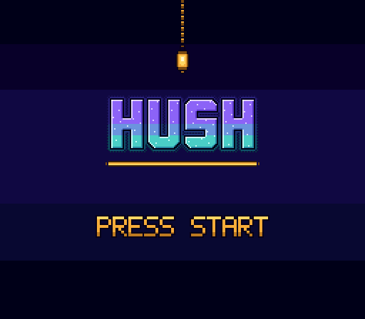
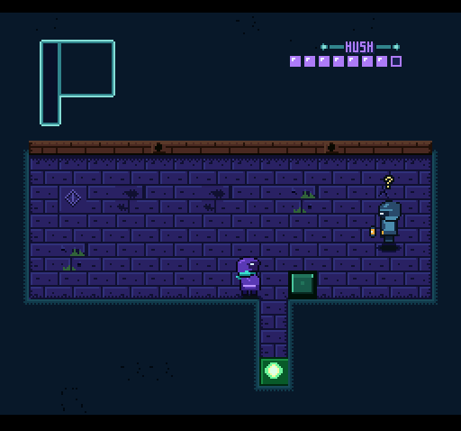
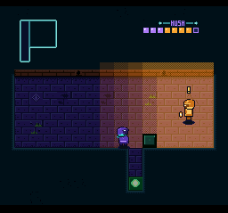
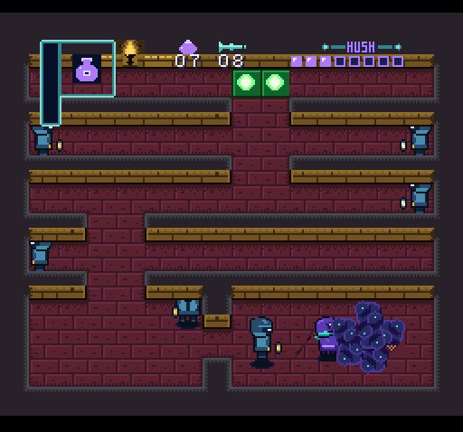

# HUSH

A ROM hack of *The Legend of Zelda: A Link to the Past* (SNES, US 1.0). You are
a shadow thief in a vault tower of lantern-carrying guards. Your weapons are
made of shadow and melt in lantern light: unaware guards can be taken down,
alerted guards cannot be hurt at all. About 20 single-screen stealth-puzzle
rooms across 3 floors plus a final heist room.

Rules, game summary, milestones and the agent roster: **[AGENTS.md](AGENTS.md)**.
Design: [design/pillars.md](design/pillars.md).

Status: **M5 candidate**. All 21 rooms, guard AI, art, audio and the ending are
built. Hearts are replaced by a **stealth meter**: every guard that turns
suspicious ("?") or alert ("!") drains it, and an empty meter restarts the room.

| | |
|---|---|
|  |  |
| **HUSH** title | A guard spots something: "?" and a small hit to the meter |
|  |  |
| Alerted: the guard turns amber and the lost cells flash | The heist room: an Ink Pot cloud makes alerted guards lose you |

Screenshots show only HUSH's own placeholder art (`make leakcheck`: 0 vanilla
tiles or palettes).

> This repository contains no ROM and no copyrighted assets. You supply your
> own legally obtained US 1.0 ROM. The only distributable output is a BPS
> patch (`make patch` -> `dist/hush.bps`).

## Download

**[Download `hush.bps` (latest)](https://github.com/dipodidae/hush/releases/download/latest/hush.bps)**,
or see the [release page](https://github.com/dipodidae/hush/releases/tag/latest).
It is republished automatically whenever `dist/hush.bps` changes on `main`.
The patch in the repo is [`dist/hush.bps`](dist/hush.bps); a pre-commit hook
(`make hooks` to enable) rebuilds and stages it on every commit to `main`, so it
always matches the source. CI never sees the ROM.

## How to install

1. Get your own legally obtained *A Link to the Past* ROM, **US 1.0**,
   headerless (1,048,576 bytes, CRC32 `777AAC2F`). If your file is 1,049,088
   bytes it has a 512-byte copier header; remove it first
   (`tail -c +513 in.smc > alttp.sfc`).
2. Download `hush.bps` from the link above.
3. Apply the patch with a BPS patcher:
   - In the browser: [Rom Patcher JS](https://www.marcrobledo.com/RomPatcher.js/)
     (pick the ROM, pick `hush.bps`, *Apply patch*).
   - Or the command line, with [Floating IPS](https://github.com/Alcaro/Flips):
     `flips --apply hush.bps alttp.sfc hush.sfc`
4. Open `hush.sfc` in an SNES emulator (MesenCE, bsnes, snes9x) or on a
   flash cart.

If the patcher reports a checksum mismatch, your ROM is not the right version
or still has a header.

## What you must do manually (developers)

1. **Place the ROM** at `rom/vanilla.sfc`: headerless, 1,048,576 bytes,
   CRC32 `777AAC2F`. (`make build` checks this and refuses anything else. A
   512-byte copier header is reported, never stripped for you:
   `tail -c +513 in.smc > rom/vanilla.sfc`.)
2. **Make `tests/states/test_room.mss`** (see below).
3. **ZScream** (Windows GUI editor for ALttP dungeons/overworld) is for you to
   use for room layout. It is not installed or automated here. Get it from
   <https://github.com/Zarby89/ZScreamDungeon>.
4. Optional: `cp .env.example .env.local` if you need to override tool paths.
   `.env.local` is gitignored; never commit secrets.

## Setup (Linux x86_64, Debian/Ubuntu)

```
sudo apt-get install -y cmake xvfb python3-venv libsdl2-2.0-0   # once
make setup      # builds asar + flips into .tools/, downloads MesenCE 2.2.1, makes .venv/
make vendor     # optional: reference disassemblies into vendor/ (gitignored)
cp /path/to/your/rom.sfc rom/vanilla.sfc
make build && make test
```

`make setup` prints the exact `apt` line if something is missing. Tool versions
used: asar 1.91, Floating IPS v198 (CLI build), MesenCE 2.2.1
(`github.com/nesdev-org/MesenCE`), Python 3.14 with Pillow and PyYAML.

## Commands

| Command | Does |
|---|---|
| `make setup` | install/build local tools into `.tools/` and `.venv/` |
| `make vendor` | clone the reference disassemblies into `vendor/` at pinned commits |
| `make rooms` | compile `design/rooms/*.yaml` (or `HUSH_ROOMS_DIR`) with `tools/roomgen.py` into `build/rooms_gen.asm`, `build/rooms_report.txt`, `build/rooms_gen.lua`; `make build` runs it first (E1; see `docs/engine_notes.md`) |
| `make build` | verify ROM CRC, copy to `build/hush.sfc`, assemble `src/main.asm` (fails on any asar warning), enforce `src/FREESPACE.md` |
| `make patch` | build, then `dist/hush.bps` with flips |
| `make validate` | check `design/rooms/*.yaml` against the schema |
| `make test` | smoke + solution tests, headless; pass/fail table. `STRICT=1` fails on skips |
| `make chaos` | fuzz tests in `tests/chaos/` (none yet) |
| `make check` | build + validate + test |
| `make clean` | remove `build/` |

## Making `tests/states/test_room.mss`

Savestates need a real display, so you make this one by hand in the MesenCE GUI.

1. Build first: `make build` (the state must come from `build/hush.sfc` so it
   matches the code under test).
2. Start MesenCE: `.tools/mesen/Mesen build/hush.sfc`
   (needs a desktop session; on first run it asks where to keep its data, any
   choice is fine).
3. Play to a **dungeon room** where Link is standing in open floor, **under
   your control** (no text box, no transition), with space to walk right for
   a second. Any dungeon room works for M0 (Link's house, Hyrule Castle,
   Sanctuary...). Later milestones will replace this with the real test room.
4. Save the state **to a file**: in the menu choose *Game* (or the save-state
   menu, `Shift`+`F-key` slots are slots, not files) then **Save State to File...**,
   and save as `tests/states/test_room.mss`. (MesenCE: *Game > Save State >
   Save to file...*; wording may vary slightly by version.)
5. Check it: `make test STRICT=1`. `smoke_read_link` and `smoke_determinism`
   should now PASS instead of SKIP.

Notes:
- Savestates belong to the emulator version (MesenCE 2.2.1 here) and to the
  code that was running. If you change hooks or upgrade MesenCE, remake it.
- `tests/states/*.mss` is gitignored (it embeds ROM-derived data).
- Self-check without your state: `.venv/bin/python tools/run_test.py
  tests/dev/make_dev_state.lua` plays the game from boot into Link's house and
  writes `build/dev_states/linkhouse.mss`; then run
  `tools/run_test.py tests/smoke/read_link.lua --state build/dev_states/linkhouse.mss`.

## Headless emulator notes

- MesenCE `--testRunner` runs a Lua script at max speed, headless (no window,
  but it still initialises SDL; on Linux without `$DISPLAY` the runner wraps it
  in `xvfb-run`). Exit code = `emu.stop(code)`; no stop within `--timeout`
  seconds = failure.
- `tools/run_test.py` uses an isolated `$HOME` per test with Lua I/O enabled
  and settings never saved. See `tests/README.md` for the test API.
- **scawful/mesen2-oos** (a Mesen2 fork for Oracle of Secrets with a socket
  API and Zelda 3 views): evaluated, **not adopted**. It has no releases (build
  from source only), its README documents almost nothing about the API, it
  targets a different hack, and MesenCE's `--testRunner` + Lua already covers
  everything M0-M5 needs. Revisit only if we need live external control (a
  socket) rather than scripted runs.

## Layout

See [AGENTS.md](AGENTS.md#layout). Agents live in `.opencode/agents/`
(opencode 1.19.5 frontmatter format: `permission:` map, last match wins);
commands `/build /test /chaos /gate` in `.opencode/commands/`.

## Credits and licences

asar (RPGHacker), Floating IPS (Alcaro), MesenCE (nesdev-org; GPLv3), and the
ALttP disassemblies by MathOnNapkins, Kan (spannerisms) and JaredBrian, used
read-only as reference. ALttP is (c) Nintendo; this project distributes only a
patch.
